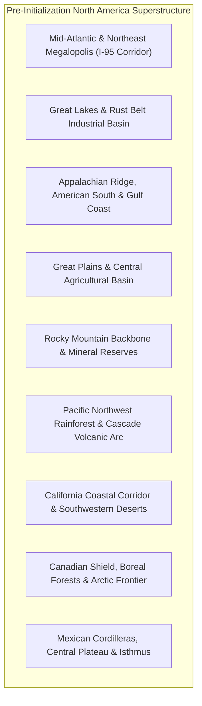
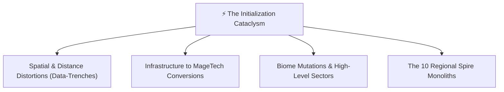
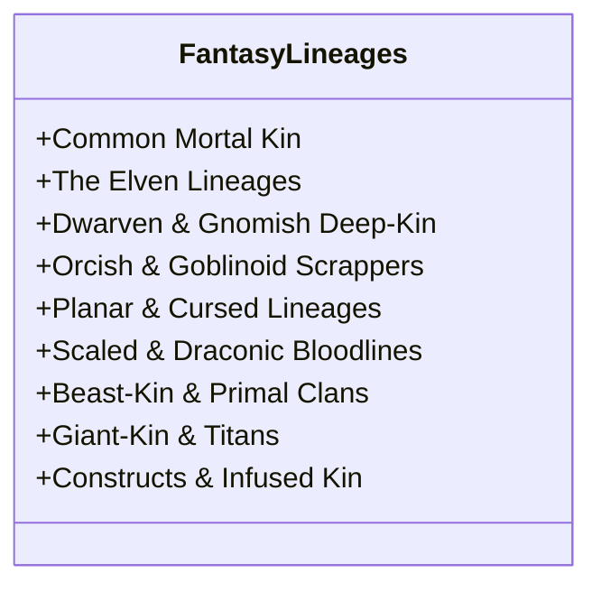
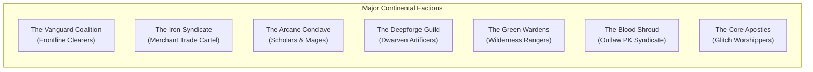

# 🗺️ The Fractured Overlay: North America Pre- & Post-Initialization Atlas
*A Comprehensive Geographic, Sociopolitical, and Systemic World-State Guide for The Fractured Earth*

---

## 📌 Executive Overview & Core World Grounding

**The Fractured Overlay** operates on a layered reality: **our real, modern Earth**, violently rewritten by an ancient, hyper-complex gaming substrate known as the **Cardinal System**. 

### Foundational Tenets
1. **Real-World Geography Retained (With Distance Warping):**
   - The places, cities, counties, rivers, mountains, and historic sites of North America exist in their true geographic locations, but the space between them has been distorted by the Cardinal System’s spatial partitioning algorithms. Distances are non-Euclidean: a 10-mile stretch of Route 57 or I-80 may unfold into a 50-mile treacherous data-trench, while certain compressed mountain passes span miles in mere hundreds of paces.
2. **MageTech Fantasy (No Modern Gunpowder or Sci-Fi Tropes):**
   - Technology is entirely driven by arcane physics: **Aether-Casters**, brass-and-crystal firearms firing glyphic mana-cartridges, geothermal deep-forges, living leyline conduits, and clockwork/runic **Golems**.
3. **Universal Fantasy Species Roster:**
   - The integration populated the continent with every known fantasy species from D&D, Pathfinder, and classic mythologies. They did not drop from the sky; humanity and local populations awoke with ancient bloodlines unsealed, while native fantasy races integrated directly into the geographic topography.
4. **Universal Companion Dynamic & Organic Agency:**
   - **No companion is forced upon the player.** Characters like **Ren Sasaki** exist as autonomous individuals in the world. Players may befriend them, hire them, abandon them, or ignore them completely. Virtually any sentient NPC in the world can become a party companion or hireling through roleplay, diplomacy, shared alignment, or reciprocal favors.
5. **Legitimate Real Estate & Economic Grounding:**
   - Homesteads, manors, and safe-zone parcels are municipal assets governed by local Baronies and Council Wardens. They must be purchased through substantial Col expenditures, municipal deed filings, and local reputation—never handed out.
   - *Note on Playtesting Gear:* Banki’s current high-tier armaments (*Fenrir's Tusk*, *Mjöllnir-Null*, *Einherjar Rig*, and Col reserves) are explicitly recognized as an **Administrator / Playtesting Override loadout** for systems testing, distinct from baseline player progression.

---

## 🌎 Part I: Pre-Initialization North America Baseline

Before the Cardinal System's cataclysmic *Initialization Event*, North America was a technologically advanced, highly interconnected continental superstructure. Below is the geographical and infrastructural baseline:

### 1. Mid-Atlantic & Northeast Megalopolis (The Core Anchor: NJ, NY, PA, DE, MD, New England)
* **Anchor Hub:** **Washington Borough, NJ (07882)** — Located in the rural-suburban crossroads of Warren County, where historic Route 31 and Route 57 intersect between the Pohatcong and Scotts Mountain ridges.
* **Infrastructural Backbone:** The densest municipal, transit, and electrical corridor on the continent. Connected via the I-95/I-78/I-80 arteries, the Northeast Corridor rail line, decommissioned historic canals (Morris Canal, Delaware & Raritan Canal), and subterranean municipal aqueduct networks.
* **Geographic Topography:** Rolling Appalachian foothills, deep glacial valleys, rich limestone soil, dense deciduous forests (Pine Barrens, Pocono range), and major navigable waterways (Delaware, Lehigh, Hudson, and Susquehanna Rivers).

### 2. The Great Lakes & Rust Belt Industrial Basin (OH, MI, IN, IL, WI, Western PA/NY)
* **Character:** Massive heavy-manufacturing corridors, colossal steel mills, shipping ports, automotive production plants, and sprawling railway switchyards.
* **Waterways:** The five Great Lakes (Superior, Michigan, Huron, Erie, Ontario) acting as inland freshwater seas connecting to the St. Lawrence Seaway.
* **Key Metropolises:** Chicago, Detroit, Cleveland, Pittsburgh, Buffalo, Milwaukee.

### 3. The Appalachian Mountains, American South & Gulf Coast (VA, NC, SC, GA, FL, TN, KY, AL, MS, LA)
* **Character:** Ancient, weathered mountain ridges, deep temperate rainforest hollows, vast pine flatwoods, limestone karst caverns (Mammoth Cave), and subtropical delta bayous.
* **Infrastructural Nodes:** Port of New Orleans, Gulf offshore oil/gas platforms, Tennessee Valley hydroelectric dam networks, Oak Ridge laboratory complexes.

### 4. The Great Plains & Central Agricultural Basin (MN, IA, MO, ND, SD, NE, KS, OK, TX)
* **Character:** Boundless flat prairies, the Ogallala Aquifer, continental tornado corridors, and the primary grain, cattle, and biofuel breadbasket of the continent.
* **Infrastructural Nodes:** Interstate 35 corridor, immense grain elevator complexes, deep underground missile-silo fields, and transcontinental freight rail lines.

### 5. The Rocky Mountain Backbone & Continental Divide (MT, ID, WY, CO, UT, NM)
* **Character:** Soaring granitic peaks exceeding 14,000 feet, alpine tundra, deep river canyons, rich mineral deposits (molybdenum, silver, gold, uranium), and geothermal hotspots (Yellowstone Caldera).
* **Infrastructural Nodes:** Cheyenne Mountain / NORAD complexes, federal gold depositories (Denver), transcontinental mountain tunnel bores (Eisenhower Tunnel, Moffat Tunnel).

### 6. The Pacific Northwest & Cascade Volcanic Arc (WA, OR, Northern CA, British Columbia)
* **Character:** Dense temperate rainforests (Olympic Peninsula), volcanic stratovolcanoes (Mt. Rainier, Mt. St. Helens, Mt. Hood), and deep fjord coastlines.
* **Infrastructural Nodes:** Columbia River hydroelectric megastructures (Grand Coulee Dam), tech manufacturing clusters, deepwater ports (Seattle, Vancouver).

### 7. California & Southwestern Arid Basin (CA, NV, AZ, UT)
* **Character:** Arid Mojave and Sonoran deserts, deep rift valleys (Death Valley), fertile Central Valley agriculture, and high-density tech corridors.
* **Infrastructural Nodes:** Hoover Dam / Lake Mead, California Aqueduct system, aerospace testing facilities (Edwards AFB, Nellis range).

### 8. The Canadian Shield, Boreal Forests & Arctic Frontier (ON, QC, MB, SK, AB, BC, Territories, Alaska)
* **Character:** Massive granite bedrock outcroppings, millions of glacial lakes, vast subarctic taiga, permafrost tundra, and isolated resource extraction towns.
* **Infrastructural Nodes:** Trans-Canada Highway, James Bay hydroelectric megaproject, Athabasca oil sands, deep subarctic radar arrays (DEW Line).

### 9. Mexico, Central Cordilleras & Mesoamerican Isthmus
* **Character:** Rugged Sierra Madre ranges (Oriental, Occidental, del Sur), the high-altitude Central Mexican Plateau, volcanic belts (Popocatépetl), and dense tropical rainforests of the Yucatán and Chiapas.
* **Infrastructural Nodes:** Mexico City megalopolis, Gulf crude terminals, Pan-American Highway network, historic colonial mining districts (Guanajuato, Zacatecas).

---

## ⚡ Part II: The Initialization Cataclysm & World-State Transformations

When the **Cardinal System** forced the *Fractured Earth Overlay*, North America was not destroyed—it was **recompiled**. Below is a curated analysis of the spatial, mechanical, and ecological transformations occurring across the continent:

### 1. Spatial & Topographical Distortions
* **The "Data-Trench" Phenomena:**
  * Major highway corridors (I-80, I-95, I-70, Route 66) fractured into deep, sheer-walled rock and aether chasms known as **Data-Trenches**. While cities remain in their relative positions, travel between them now requires descending into these monster-infested canyons or trekking along hazardous mountain ridges.
  * Certain wilderness areas expanded tenfold in internal surface area due to Cardinal's procedural landscape generation, while safe zones became densely compressed pockets.
* **Non-Euclidean Ley-Faults:**
  * The Delaware Water Gap and Lehigh River valleys became **Ley-Faults**—places where spatial geometry bends. A traveler walking north may find compass needles spinning wildly while climbing ridges that loop back on themselves unless guided by an *Aether-Scholar* or *Cartographer*.

### 2. Infrastructure-to-MageTech Conversions
* **Dams $\rightarrow$ Megawatt Arcane Siphons:**
  * Hydroelectric dams (Hoover Dam, Grand Coulee, Niagara Falls) no longer generate electricity. The rushing water now turns colossal crystalline turbines that refine raw ambient mana into **Concentrated Aether-Flux**, making them heavily fortified prize-fortresses contested by Grand Alliances.
* **Railways $\rightarrow$ Runic Mag-Lev Tracks & Instanced Dungeons:**
  * Decommissioned freight lines and subways transformed into either high-speed runic ley-tracks (accessible only via Baronial Transit Charters) or subterranean instanced labyrinths crawling with clockwork constructs and corrupted ghouls.
* **Power Grids $\rightarrow$ The Continental Ley-Grid:**
  * High-voltage transmission lines decayed into inert steel towers draped in glowing mana-moss. In their place, a web of underground **Leyline Currents** pulses through the Earth, bursting through the surface at historical crossroads, old churches, and ancient geological faults.
* **Nuclear Plants & Silos $\rightarrow$ Glitch-Reactor Bastions:**
  * Nuclear generation stations and missile silos suffered "Data Meltdowns." They are now **Glitch-Hive Citadels** bathed in glowing purple radiation that mutates living flesh into Golem-Grafts or aberrant abominations.

### 3. Regional Macro-Transformations Across North America
1. **Sector 1 (The Warren County & NJ-PA Overlay):**
   * *Anchor Town:* Washington Borough Safe Zone.
   * *Terrain:* Runic farming communes, dense dire-wolf forests (Roaring Rock), instanced iron-mine labyrinths (Pohatcong Depths), and natural boundary mountains acting as safe-zone firewalls.
2. **The New York Spire Ruins (The Crystalline Monolith):**
   * Manhattan's skyscrapers fused into a singular, colossal mountain of black glass and crystalline data-ribs, designated as the **Eastern Central Monolith**. It is the ultimate raid dungeon of the Mid-Atlantic Sectors, surrounded by a toxic sea of glowing Hudson mana-sludge.
3. **The Great Lakes Freshwater Seas:**
   * Lake Erie and Lake Michigan became monster-infested inland oceans known as the **Azure Abyssal Basins**. Giant mechanical leviathans and aquatic sirens prey on player barges transporting refined alloy between Chicago and Cleveland.
4. **The Pine Barrens "Glitch-Fey" Unmapped Expanse:**
   * Southern New Jersey's Pine Barrens mutated into an infinite, shifting forest where the Cardinal System’s procedural generation scripts run unchecked. Players who step off the marked fire-roads find themselves stalked by the *Jersey Glitch-Devil* and ancient fey-constructs.
5. **The Appalachian Dwarven Deep-Holds:**
   * The coal mines of Pennsylvania, West Virginia, and Kentucky collapsed and re-opened as colossal subterranean Dwarven holds and deep-forges. Dwarven and Gnomish clans dominate the subterranean trade networks, supplying the surface with refined aether-alloy.
6. **The Great Plains "Dust-Titan" Migration:**
   * The Midwest prairies became the **Vast Roaming Expanse**, crossed by colossal wandering field bosses (colossal mechanical behemoths and thunder-bisons miles wide) whose footfalls shatter local terrain.
7. **The Rocky Mountain Sky-Bastions & Dragon Peaks:**
   * Colorado and Wyoming peaks are ruled by elemental Dragonborn aeries and Goliath shock-troops. Deep beneath Cheyenne Mountain lies the **Hollow Vault**, a legendary pre-collapse bunker rumored to contain the Cardinal System's original source-code archives.
8. **The Southwestern Sun-Glass Wastes:**
   * Nevada and Arizona deserts fused into iridescent sheets of green sun-glass. Solar-powered kinetic constructs and fire-elemental clans guard the precious aether-reservoirs of Lake Mead.

---

## 🧬 Part III: The Universal Species & Lineages Taxonomy

The Initialization permanently integrated all classic fantasy species into the world. In this MageTech setting, racial traits reflect ancient biological protocols and aetheric resonance:

### 1. Common Mortal Kin
* **Humans (Phrenic, Standard, Strain-Resistant):**
  * *Trait:* Highly adaptable, versatile bonus feats, natural diplomatic bridge across factions.
  * *Phrenic Humans:* Awakened with psionic telekinesis and telepathy, but vulnerable to sensory overload.
* **Halflings (Lightfoot, Stout, Ghostwise):**
  * *Role:* Master scavengers, stealth couriers, and black-market smugglers.
  * *Traits:* Supernatural luck (reroll natural 1s), resistance to fear effects, exceptional evasion in tight data-trenches.

### 2. The Elven Lineages (D&D / Pathfinder / High Fantasy)
* **Highborn Elves (Aether-Tech Oligarchs):**
  * Dominate corporate guilds and arcane banking institutions. Masters of crystalline spell-casting and aether-refining.
* **Wood Elves (Wilderness Wardens):**
  * Guardians of unmapped wilderness corridors. Natural affinity for camouflage, tracking, and long-range caster rifles.
* **Drow / Cavern Elves (Subterranean Syndicates):**
  * Exiled to underground subway veins and abandoned mine shafts. Run the black-market poisons, stealth assassinations, and shadow-casting networks.
* **Eladrin / Fey-Touched:**
  * Seasonally shifting humanoids whose emotional state alters their elemental magic (Winter frost, Summer fire).

### 3. Dwarven & Gnomish Deep-Kin
* **Mountain & Shield Dwarves (Deepforgers):**
  * Master craftsmen operating geothermal foundries. Natural +2 CON, stonecunning (bonus to detecting dungeon traps and secret masonry), and poison/toxin resistance.
* **Duergar (Void-Dwarves):**
  * Subterranean psionic smiths who specialize in crafting cursed or soul-bound armaments.
* **Rock Gnomes & Tinker Gnomes (MageTech Artificers):**
  * Brilliant, eccentric inventors who design mechanical gadgets, clockwork traps, and runic cartography slates.
* **Deep Gnomes (Svirfneblin):**
  * Cautious cavern dwellers with natural illusory concealment and blind-sense.

### 4. Orcish, Goblinoid & Scrapper Bloodlines
* **Orcs & Half-Orcs (Frontline Juggernauts):**
  * Relentless warriors with *Relentless Endurance* (dropping to 1 HP instead of 0 once per long rest) and ferocious melee critical strikes. Highly valued as frontline vanguard assault troops.
* **Hobgoblins (Martial Tacticians):**
  * Disciplined, iron-fisted mercenary companies running militarized caravan escorts with rigid formation fighting bonuses.
* **Goblins (Scrap-Mancers & Riggers):**
  * Hyperactive salvage experts who build deadly weapons from broken junk, razor-wire, and volatile mana-capsules.
* **Bugbears (Ambush Predators):**
  * Massive stealth shock-troops with extended reach and devastating first-strike ambush damage.

### 5. Scaled, Draconic & Reptilian Lineages
* **Dragonborn (Chromatic & Metallic Houses):**
  * Noble, elemental heavy mercenaries. Possess elemental breath weapons (Fire, Cold, Lightning, Acid, Poison) and armored draconic scales (+1 natural AC).
* **Kobolds (Trap-Savants):**
  * Small, cunning subterranean builders with pack tactics and innate trap-laying genius.
* **Lizardfolk & Naga:**
  * Cold-blooded, pragmatic survivalists dominating swamp deltas, flooded river systems, and coastal bayous.

### 6. Planar-Touched & Cursed Bloodlines
* **Tieflings (Hellfire & Glitch-Born):**
  * Horned, tail-bearing humanoids infused with infernal or corrupt glitch data. Natural fire resistance, darkvision, and innate thaumaturgy spells.
* **Aasimar (Celestial Protocols):**
  * Blessed with radiant haloes and healing touch. Often serve as paladins and high adjudicators in safe-zone councils.
* **Genasi (Air, Earth, Fire, Water):**
  * Elemental-infused humanoids embodying planetary forces; immune to environmental extreme hazards of their element.
* **Dhampir & Reborn:**
  * Half-living survivors untouched by hunger or exhaustion, retaining darkvision and vampiric bite or necrotic resistance.

### 7. Beast-Kin & Primal Clans
* **Tabaxi & Catfolk:** Agile scouts with burst sprint speed and feline climbing claws.
* **Leonin & Lycans (Lupine & Ursine):** Pride warriors and shape-shifting wolf/bear clans dominating wild provincial forests.
* **Kitsune (Nine-Tailed Tricksters):** Shape-shifting vulpine enchanters specializing in illusion and spirit fire.
* **Kenku & Tengu:** Crow-folk mimics and stealth saboteurs operating in ruined urban spires.
* **Ysoki (Ratfolk):** Gregarious, resilient underground scavengers who excel at pack hoarding and tunnel navigation.

### 8. Giant-Kin & Colossi
* **Goliaths:** Massive mountain-born athletes with *Stone’s Endurance* (shrugging off heavy physical damage) and high carry weight thresholds.
* **Firbolgs:** Gentle, nature-attuned woodland giants with speech of beast and leaf, capable of turning invisible for short bursts.

### 9. Constructs & Synthetics
* **Golems (Playable Clockwork / Runic Constructs):**
  * Ancient Warforged beings created from enchanted stone, brass, and living wood. They do not eat, sleep, or breathe; immune to disease, but require field mending and oil to restore durability.
* **Graft-Touched:**
  * Any mortal species that has replaced $50\%+$ of their organic body with Golem-Grafts, walking the razor-thin line between transcendent power and fatal System Rejection.

---

## 🏛️ Part IV: Expanded Faction & Guild Ecosystem

The sociopolitical landscape is a fierce web of competing alliances, merchant syndicates, and outlaw networks:

### 1. The Vanguard Coalition (The Frontline Raiders)
* **Philosophy:** "Break the Spires. Free Humanity."
* **Leadership:** High Commander Vance (Human Paladin) and Lead Scout Lyra (Wood Elf Ranger).
* **Presence:** Fortified forward command posts at every major Sector Gate and dungeon entrance.
* **Perks for Players:** Grants access to high-tier raid bounties, specialized anti-boss consumable oils, and safe passage along frontline transit routes.

### 2. The Iron Syndicate (The Mercantile Cartel)
* **Philosophy:** "Gold and Aether Rule the Earth."
* **Leadership:** High Factor Malakar (Dwarf Trader) and Baroness Vane (High Elf Artificer).
* **Presence:** Controls the markets, auctions, and trade warehouses in every municipal safe zone.
* **Perks for Players:** Standing discounts on raw commodities (up to 15%), exclusive access to rare metal ingots, and safe-deposit vault insurance.

### 3. The Arcane Conclave / Synod of the Silver Spire
* **Philosophy:** "Understand the Cardinal Code; Master the Reality."
* **Membership:** Elven scholars, human psions, and gnome researchers studying the nature of the Integration.
* **Perks for Players:** Sells high-tier spell scrolls, identifies unmapped glyphs, and offers surgical harmonization services to negate graft casting penalties.

### 4. The Deepforge Guild (Dwarven & Gnomish Union)
* **Philosophy:** "If it cannot be forged, it cannot endure."
* **Presence:** Subterranean foundry bastions throughout the Appalachian and Rocky Mountain corridors.
* **Perks for Players:** The only craftsmen capable of assisting with Master-Anvil construction and Grade 6+ Mythic equipment blue-printing.

### 5. The Green Wardens (The Pine Barrens Rangers)
* **Philosophy:** "The primal earth will reclaim the artificial."
* **Membership:** Beast-Kin, Firbolgs, and Wood Elf rangers who live outside the safe-zone barriers.
* **Perks for Players:** Provides wilderness tracking maps, stealth camouflage cloaks, and safe camp coordinates free from nocturnal stalker ambushes.

### 6. The Blood Shroud (The Crimson PK Syndicate)
* **Philosophy:** "There is no real world to return to. The strong harvest the weak."
* **Status:** The primary **Red Cursor** outlaw syndicate. They operate from hidden caves and ruins outside safe-zone boundaries.
* **Threat:** Ambush players in wilderness data-trenches, hoard boss cores for extortion, and execute player-killing contracts.

### 7. The Core Apostles (The Glitch Cult)
* **Philosophy:** "The Cardinal System is God. Human form is a bug to be purged."
* **Threat:** Religious zealots heavily augmented with corrupted Golem-Grafts who intentionally destabilize regional safe-zone firewalls.

---

## 🤝 Part V: Companion Autonomy & Real Estate Rules

### 1. Universal Companion Autonomy (Ren Sasaki & Beyond)
* **Ren Sasaki is NOT an obligatory party member:**
  * When a player begins their journey, Ren Sasaki is an NPC surviving in the world. He has his own personality: a nervous, brilliant MageTech QA researcher who is terrified of combat but possesses invaluable knowledge of collision geometry and leyline telemetry.
  * **Player Freedom:** The player can choose to befriend Ren, hire him, ignore him, or leave him behind in the safe zone. He will not auto-join the player's HUD party unless the player explicitly extends a party invitation and earns his trust.
* **Dynamic Recruitable NPCs:**
  * Almost *any* sentient NPC in the world can become an active companion:
    * A stoic Goliath mercenary resting at the Iron Spoke Taphouse.
    * A rescued Goblin tinker trapped in a Pohatcong Depths cage.
    * An Elven spell-weaver researching leyline rifts at the library.
    * A wandering Beast-Kin ranger encountered by a wilderness campfire.
  * **Recruitment System:** Depends on personal affinity, moral alignment, successful roleplay dialogue, shared combat victories, and completing personal companion requests.
  * **Affinity & Stances:** Companions develop affinity (0–100). Reaching 50 unlocks signature **Dual-Tech Combos**, and each companion operates under customizable **Tactical Stances** matching their archetype.

### 2. Legitimate Real Estate & Economic Grounding
* **Homesteads Must Be Earned:**
  * Real estate (such as the *Washington Borough Manor*, *Oxford Foundry Estate*, or *Pocono Wilderness Lodge*) is strictly **purchase-only**.
  * Properties require substantial Col, deed registration with the Municipal Council, and clean (Green) Cursor standing. No estate or vault is handed out for free.
* **Playtesting Gear Disclaimer:**
  * Banki's current starting inventory containing Grade 5 equipment (*Fenrir's Tusk*, *Mjöllnir-Null*, *Einherjar Rig*) and surplus Col is recognized as an **Administrator / Playtesting Override loadout** utilized for mechanical verification and stress-testing. Baseline players start with standard Common starter weapons and zero Col.

---

## 🔮 Part VI: Suggested Initialization Transformations (To Be Implemented)

Below is the structured list of recommended changes to implement across the world-state during the Initialization cataclysm:

1. **The Route 31 / Route 57 Great Trench:**
   - Washington Borough sits elevated on a fortified limestone plateau, while the highways radiating from it have sheared into 80-foot deep data-trenches populated by crawling Rust-Scorpions and Razor-Hounds.
2. **The Oxford Slag Labyrinth:**
   - The historic Oxford Furnace and iron pits become an open-air industrial dungeon ruled by renegade Clockwork Golems smelting scrap metal for a rogue forge-master.
3. **The Delaware River Mana-Torrent:**
   - The Delaware River glows with incandescent blue light, flowing with raw liquefied mana. Crossing without a warded ferry causes Aether-Sickness unless protected by alchemical draughts.
4. **The High Point Crystalline Spire:**
   - High Point State Park (NJ's highest peak) is crowned by a floating crystalline needle that radiates the regional safe-zone barrier frequency. If its defense cores are compromised, safe-zone protections across northern NJ temporarily flicker.
5. **The Morris Canal Arcane Aqueduct:**
   - The ancient canal's dry lock system functions as a network of gravitational slipstreams, allowing players on foot to slide rapidly between towns at 3x overland speed if they avoid the territorial territorial water-elemental lurkers.
6. **The Great Pennsylvania Under-Barrow:**
   - The coal mines of Bethlehem and Easton connect into an immense subterranean underworld spanning hundreds of miles into the Appalachian interior, establishing the primary underground highway for Dwarven and Drow traders.
7. **The NYC Ruin Firewall:**
   - Entering the New York metropolitan basin requires Level 25+ clearance; the Hudson River is bounded by a towering, translucent crimson hex-grid firewall that vaporizes unauthorized low-level avatars on contact.
8. **Dynamic Planetary Aether-Storms:**
   - Continental weather fronts (Nor'easters, Gulf hurricanes, Prairie supercells) carry raw magic, spawning temporary "Rift Portals" that dump high-tier loot caches and legendary wandering world bosses for 24-hour windows.
