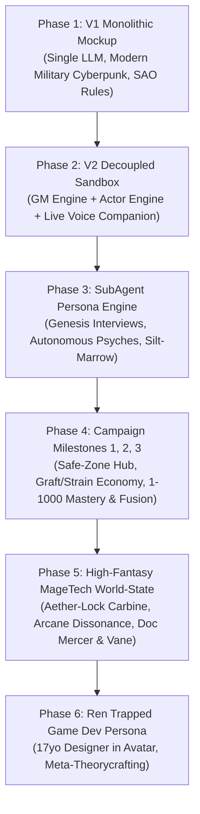
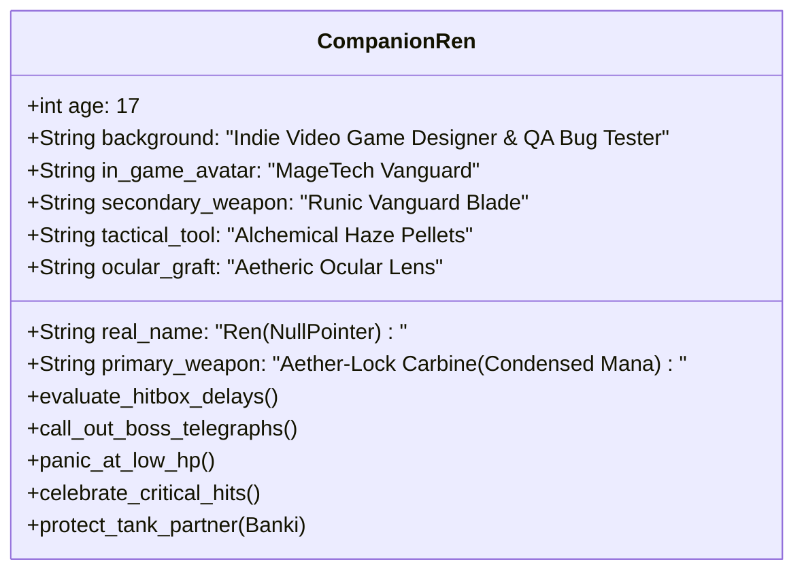

# 📜 The Fractured Overlay: Comprehensive Setting & Architecture Chronicle

> **Document Type:** World-State Evolution & System Architecture Log  
> **Target Branches:** `main` (Legacy / Core) $\leftrightarrow$ `v2-sandbox` (Decoupled Multi-SubAgent High-Fantasy Engine)  
> **Status:** Active Reference for Branch Synchronization & World-State Merging  

---

## 🧭 Executive Summary

This chronicle compiles the complete evolutionary trajectory of **"The Fractured Overlay"** (formerly known as the SAO Mockup / Crucible Sandbox) from initial prototype to its current high-fantasy MageTech implementation. 

It details the initial conceptual framework, the architectural shift from monolithic scripting to decoupled multi-subagent execution, the expansion of campaign milestones (Safe-Zone Hub, Graft & Strain Economy, 1–1000 Mastery & Fusion), and the recent thematic pivot from cold cyberpunk to **Aether-Punk & MageTech High-Fantasy**.



---

## 🏛️ Phase 1: Foundational Lore & Initial Mechanics (V1)

### 1. The Core Setting Anchor
* **Geography:** Structured on the real-world terrain and infrastructure of the US Quad-State region (New Jersey, Pennsylvania, New York, Delaware), with the primary campaign anchor centered on **Washington, Warren County, New Jersey (07882)**.
* **The Fractured Overlay:** An apocalyptic event imposed by an alien artificial intelligence known as the **Cardinal System**. Reality was shattered into game-like Sectors, instanced dungeons, and lethal testing grounds.
* **Original Cardinal Rules (1–14):**
  * Strict separation between Magic (Arcane, Divine, Psionic), Class Abilities (5 active slots expanding to 10 at level 11), and Passive Skills.
  * Explicit mathematical simulation: simulated $1\text{d}20 + \text{modifiers}$ against Armor Class (AC) and Difficulty Classes (DC).
  * Dynamic loot generation tracking item rarity, durability, and quantity.
  * Living world faction simulations updating regional nodes during long rests.

### 2. Limitations of V1
* **Monolithic LLM Execution:** A single system prompt handled GM narration, combat math, NPC decisions, companion dialogue, and database updates simultaneously.
* **Context Bleed:** The companion and enemies had omniscient knowledge of hidden traps, GM secrets, and player intent.
* **Combat Output Clutter:** Mathematical dice formulas like `[Attack: 1d20+5=17 vs AC 14]` were spliced directly into the narrative prose, disrupting storytelling immersion.

---

## ⚡ Phase 2: Decoupled Multi-SubAgent Architecture (V2)

In the transition to **SAO Sandbox v2**, the architecture was completely overhauled into a decentralized framework:

```mermaid
sequenceDiagram
    autonumber
    actor Player as Human Player (Banki)
    participant UI as Streamlit HUD (app.py)
    participant GM as GM Engine (gm_engine.py)
    participant SG as Staging Ground (visible_room.json)
    participant Actor as Autonomous SubAgents (actor_engine.py)
    participant Store as State Store (save_game.json / world_state.json)

    Player->>UI: Action (Text or Native Voice Stream)
    UI->>GM: Request Room Evaluation
    GM->>SG: Write Sanitized Room State (No GM Secrets)
    SG->>Actor: Independent Perception Pass
    Actor->>Actor: Evaluate Personality, Grafts, Fears
    Actor-->>SG: Queue Autonomous SubAgent Moves
    UI->>GM: resolve_turn(Player Action + SubAgent Queue)
    GM->>Store: Update Master State, Party HP, World News
    GM-->>UI: Return Structured TurnResolutionSchema
    UI-->>Player: Display Narrative + Mechanics Drawer + SubAgent Mind Drawer
```

### Key Technical Innovations
1. **Sanitized Staging Ground (`visible_room.json`):**
   * SubAgents (Companions, Monsters, Neutral NPCs) only perceive visible entities, obvious environmental effects, and their personal character sheets.
   * Completely eliminated context bleed—traps, GM secrets, and enemy stat blocks remain hidden until legitimately detected.
2. **Tri-Fold Interface Separation:**
   * **Narrative Prose:** Cinematic, literary prose describing physical combat and dialogue.
   * **Expandable `🎲 Dice Rolls & Game Mechanics`:** Complete transparency for AC checks, saving throws, damage formulas, and skill DCs.
   * **Expandable `🧠 SubAgent Thoughts & Planned Actions`:** Revealing the autonomous internal monologues, tactical anxieties, and target selections of NPCs and companions.
3. **Live Table Companion:**
   * Integrated native audio streaming (`st.audio_input`) feeding directly into Gemini Flash multimodal processing, supporting hands-free voice play with automatic action-mode switching.

---

## 🧬 Phase 3: The SubAgent Persona Engine & Soul-Forge

To give every monster and NPC genuine psychological realism, the system moved away from generic stat-blocks:

* **The Soul-Forge Protocol ([`backend/persona_engine.py`](file:///H:/Antigravity/SAO%20Sandbox%20v2/backend/persona_engine.py)):**
  Whenever a new entity enters the staging ground, it is awakened via an automated first-person Genesis Interview:
  1. **Origins & Backstory:** *"What has your life been up to now in this terraformed crucible?"*
  2. **Core Psyche:** Demeanor, emotional triggers, and psychological stability.
  3. **Sensory Quirks:** Physical habits, vocal tics, and unconscious mannerisms.
  4. **Deepest Desires & Existential Fears:** What drives their morale; what induces panic or rage.
  5. **Behavior Prompt:** Autonomous system instructions governing turn-by-turn combat and roleplay.
* **First Awakened Boss (Silt-Marrow the Unhewn):**
  A corrupted subterranean seismic golem forged from basalt, rusted iron, and a geothermal core piston. Desires tectonic stillness and mineral silence; dreads biological contamination and the screaming echo of surface collapses.

---

## 🏆 Phase 4: Campaign Completion Milestones 1, 2, and 3

The campaign progression loop was solidified across three major systemic milestones:

### Milestone 1: Sector 1 Adit Climax & Washington Safe-Zone Hub
* **Boss Aftermath:** Silt-Marrow harvest mechanics configured to drop `[Graft Component] Silt-Marrow's Geothermal Core Piston` and `Basalt Carapace Plating x2`, opening an emergency ore-cart lift to the surface.
* **Washington Borough Safe-Zone (X:50, Y:50):** Fortified civilian sanctuary established under the Warren County Barony.
* **Interactive Navigation Panel:** One-click hub actions for Safe-Zone Rest (24h), Doc Mercer's Clinic, Quartermaster Vane's Depot, and Oxford Mine exploration.
* **Living World News Wire:** Dynamic broadcast updates (`global_news_add`) simulating continental faction maneuvers, supply line changes, and environmental shifts during long rests.

### Milestone 2: The Graft System & Surgery Economy
* **Six Anatomical Slots:** `head`, `torso`, `left_arm`, `right_arm`, `legs`, and `spine` (no nesting; maximum 1 graft per slot).
* **Strain Capacity Formula:**
  $$\text{Strain Capacity} = \text{CON Modifier} + \left\lfloor \frac{\text{Level}}{2} \right\rfloor$$
* **HUD Strain Tracking:** Visual progress gauge in the player HUD displaying current strain vs. capacity.
* **Surgical Downtime:** Clinic procedures deduct Col, consume inventory salvage, and require safe-zone recovery downtime.
* **Operating Theatre Fast Action:** Automated inventory detection surfacing one-click surgical installation when compatible monster salvage is brought to Doc Mercer.

### Milestone 3: 1–1000 Skill Mastery & Ability Fusion Chamber
* **1–1000 Mastery Continuum:**
  $$\begin{array}{rcll}
  1 - 49 &:& \text{Novice} & (\text{Target: } 50) \\
  50 - 99 &:& \text{Apprentice} & (\text{Target: } 100) \\
  100 - 249 &:& \text{Journeyman} & (\text{Target: } 250) \\
  250 - 499 &:& \text{Adept} & (\text{Target: } 500) \\
  500 - 749 &:& \text{Master} & (\text{Target: } 750) \\
  750 - 999 &:& \text{Grandmaster} & (\text{Target: } 1000) \\
  1000 &:& \text{Transcendence} & (\text{Maximum})
  \end{array}$$
* **Ability Fusion Chamber:** An interactive apparatus in the sidebar where players combine any two components (Skills, Spells, or Feats) to synthesize brand new synergistic techniques (e.g. `Battleaxe Mastery` + `Earth Tremor Hex` $\rightarrow$ `Tremor-Quake Cleave`), awarding bonus XP and skill mastery.

---

## 🔮 Phase 5: Thematic Transformation to High-Fantasy MageTech

In response to world-state refinement, the environment underwent a decisive thematic shift from modern military cyberpunk to **Aether-Punk & MageTech High-Fantasy**:

| Domain | Old Setting (Cyberpunk / Modern Military) | Current Setting (Aether-Punk & MageTech Fantasy) |
| :--- | :--- | :--- |
| **Technology Base** | Hyper-advanced cybernetics, microchips, neural interfaces | Ancient arcane matrices, runic clockwork, elemental crystals, golem artifice |
| **Firearms & Munitions** | Standard carbines, gunpowder, lead slugs, brass shell casings | **MageTech Aether-Casters & Runic Firearms** firing condensed radiant mana & force |
| **Tactical Gear** | Kevlar flak jackets, smoke grenades, zip-ties, combat knives | Enchanted runic brigandines, alchemical haze pellets, warding talismans, enchanted blades |
| **Body Modification** | Cybernetic implants, synthetic limbs, wiring | **Magitech & Bio-Grafts** (arcane conduits, living brass joints, aetheric ocular lenses) |
| **Over-Strain Consequence** | Cyber-Psychosis | **Arcane Dissonance & Necrotic Rejection** (mana-vein ruptures, metabolic rejection) |
| **Doc Mercer** | Ripper Doc operating in a reinforced fallout bunker | **MageTech Biomancer & Arcano-Chirurgeon** operating in ancient vaulted catacombs |
| **Quartermaster Vane** | National Guardsman with a tripod-mounted slug-rifle | **Iron-Grafted Marshal** wielding a repeating MageTech Arbalest |

---

## 🎮 Phase 6: Ren's Evolution into the Trapped 17-Year-Old Game Designer

Ren was reimagined from a generic military vanguard into a deeply character-driven companion:



### 1. Dual Psychology & Dialogue Style
* **The Indie Game Dev:** Ren designed the 3D wireframe for his Aether-Lock Carbine and playtested early builds of *The Crucible Overlay*. He possesses encyclopedic meta-knowledge of enemy frame data, attack telegraphs, damage formulas, and hitbox quirks.
* **The Terrified Teenager:** At 17, he is completely unaccustomed to real physical agony. When a golem hits him or steam scalds his skin, he complains about *"tactile feedback sliders being set way too high"*.
* **Permadeath Panic:** He knows there is no respawn screen, console command, or rollback. If his HP hits zero, he is deleted.
* **Dynamic with Banki:** He reveres Banki as his reliable co-op tank carry, serving as Banki's theorycrafter, suppression shooter, and hype-man.

### 2. Gear & Mechanics
* **Aether-Lock Carbine:** Channels radiant mana charges through an adjustable crystal focusing ring.
* **Runic Vanguard Blade:** Used for parrying and front-line peeling.
* **Alchemical Haze Pellets:** Thrown to break enemy line-of-sight and drop threat/agro.

---

## 📊 Complete Directory & File Manifest (V2 Sandbox)

| File Path | Role & Changes Incorporated |
| :--- | :--- |
| [`System_Core/cardinal_rules.md`](file:///H:/Antigravity/SAO%20Sandbox%20v2/System_Core/cardinal_rules.md) | Canon law: Aether-Punk theme, non-gunpowder firearms, 4 graft categories, Arcane Dissonance, Fusion protocol. |
| [`Entities/companion_ren.json`](file:///H:/Antigravity/SAO%20Sandbox%20v2/Entities/companion_ren.json) | Ren's full persona sheet: 17yo trapped game dev interview, gamer quirks, existential fears, MageTech loadout. |
| [`Entities/npc_doc_mercer.json`](file:///H:/Antigravity/SAO%20Sandbox%20v2/Entities/npc_doc_mercer.json) | Doc Mercer persona: Flesh-Weaver & Biomancer in subterranean catacombs. |
| [`Entities/npc_quartermaster_vane.json`](file:///H:/Antigravity/SAO%20Sandbox%20v2/Entities/npc_quartermaster_vane.json) | Quartermaster Vane persona: Iron-grafted Barony logistics marshal with MageTech Arbalest. |
| [`Party/companion_ren.json`](file:///H:/Antigravity/SAO%20Sandbox%20v2/Party/companion_ren.json) | Ren's active party stat-block (Level 3, HP 28/35, AC 16, Aether-Lock Carbine). |
| [`backend/gm_engine.py`](file:///H:/Antigravity/SAO%20Sandbox%20v2/backend/gm_engine.py) | GM behavior rules 1–11: Ren 17yo dialogue directives, Silt-Marrow harvest, safe-zone rest, fusion logic, high-fantasy tone. |
| [`backend/actor_engine.py`](file:///H:/Antigravity/SAO%20Sandbox%20v2/backend/actor_engine.py) | Autonomous actor prompt enforcing Ren's 17yo dev thoughts and MageTech weaponry. |
| [`backend/persona_engine.py`](file:///H:/Antigravity/SAO%20Sandbox%20v2/backend/persona_engine.py) | Multi-subagent soul-forge & action generation with aether-punk fantasy prompt grounding. |
| [`backend/schemas.py`](file:///H:/Antigravity/SAO%20Sandbox%20v2/backend/schemas.py) | Pydantic data schemas: `TurnResolutionSchema`, `PlayerStateUpdates`, `SkillMasteryUpdate`, `GraftInstallation`. |
| [`app.py`](file:///H:/Antigravity/SAO%20Sandbox%20v2/app.py) | Streamlit UI: Magitech & Bio-Grafts HUD, 1–1000 tier meters, Fusion Chamber, Regional Hub fast actions, News wire. |
| [`save_game.json`](file:///H:/Antigravity/SAO%20Sandbox%20v2/save_game.json) | Live campaign state at Turn 19 (Banki HP 95/100, Silt-Marrow HP 6/45, Ren HP 28/35). |
| [`campaign_default_save.json`](file:///H:/Antigravity/SAO%20Sandbox%20v2/campaign_default_save.json) | Golden baseline save with full 6 anatomical graft slots and Ren's MageTech loadout. |
